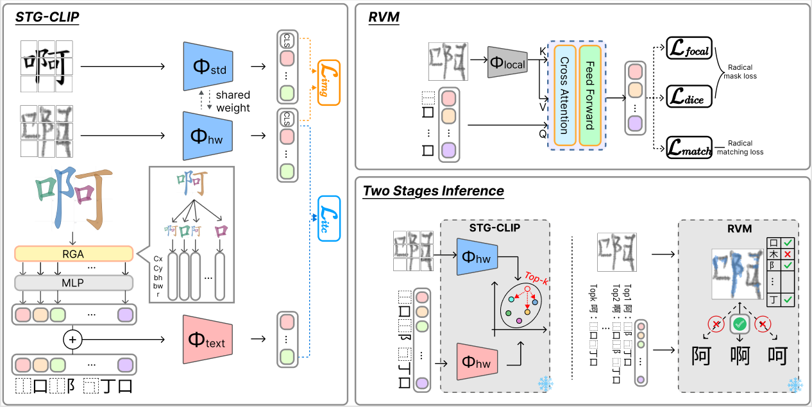

# From Global Alignment to Local Grounding: Zero-Shot Chinese Character Recognition with Radical Verification

Official PyTorch implementation of the ACCV 2026 paper.

**Yu-Heng Shih, Bing-Chen Wu, Tsz-To Wong, Ting-En Yen, Hong-Han Shuai, Bin-Hua Hsieh, Chien-An Chen, Yi-Ren Yeh, Ching-Chun Huang**

<p align="center">
  <a href="https://openreview.net/forum?id=LH7kTObY2d"></a>
  <a href="https://openreview.net/attachment?id=LH7kTObY2d&name=supplementary_material"></a>
  <a href="https://ra890927.github.io/STG-CLIP-RVM/"></a>
  <a href="https://github.com/ra890927/STG-CLIP-RVM/releases/tag/v1.0"></a>
</p>

<p align="center">
  
</p>

## Abstract

Zero-shot Chinese character recognition (ZS-CCR) aims to recognize characters whose categories are never observed during training, and typically relies on the compositional structure shared between seen and unseen characters. Recent CLIP-style methods represent this structure with the Ideographic Description Sequence (IDS) and align it with glyph images in a shared embedding space. However, they rely on a single global image–IDS similarity that discards the spatial layout of radicals and, being learned only implicitly from seen classes, generalizes poorly to unseen ones; moreover, global matching often retrieves the correct character within the top candidates yet fails to rank it first when characters differ only in subtle local radicals.

To address these issues, we propose a global-to-local two-stage framework. In the first stage, STG-CLIP augments the IDS with explicit tree-position and radical-level geometric priors, yielding a spatial-aware prototype that provides a consistent spatial description across seen and unseen categories for high-recall global retrieval. In the second stage, the Radical Verification Module (RVM) uses the radical instances of each retrieved candidate as queries to verify whether the corresponding radicals can be matched to spatially compatible regions in the input glyph. A margin-based gating rule activates the RVM only when the leading global candidates receive similar similarity scores. Experiments on the ICDAR2013 benchmark demonstrate that our method achieves state-of-the-art performance under the character-level zero-shot setting, obtaining 83.06% top-1 accuracy with 2,755 seen classes. Ablation studies further show that the explicit geometric priors and radical-level verification provide complementary improvements.

## Method

This repository implements the two stages and the gating rule:

- **STG-CLIP (global retrieval).** IDS tokens are augmented with tree-position embeddings (depth and sibling
  index) and canonical radical geometry (centroid, bounding box, area ratio). The resulting spatial-aware
  prototypes are aligned with handwritten images to retrieve a top-K candidate shortlist.
- **RVM (local verification).** The Radical Verification Module uses the radicals of each candidate as decoder
  queries over local ResNet-50 features, and scores each candidate by radical presence × glyph coverage.
- **Margin gating.** The RVM re-ranks the shortlist only when the top-1 / top-2 global scores differ by at most δ.

## Results

Top-1 accuracy on ICDAR2013 (character zero-shot: train on the first *m* GB2312 level-1 classes of
CASIA-HWDB1.0–1.1, test on the last 1,000 classes).

| Method          | 500    | 1000   | 1500   | 2000   | 2755   |
|-----------------|--------|--------|--------|--------|--------|
| FT-CLIP         | 26.17  | 50.68  | 62.25  | 70.39  | 78.96  |
| STG-CLIP        | 21.25  | 39.38  | 59.91  | 69.96  | 82.26  |
| STG-CLIP + RVM  | 22.12  | 40.52  | 63.93  | 71.48  | **83.06** |

See the paper for the radical zero-shot setting and the ablation study.

## Installation

Tested with Python 3.9, CUDA 12.6 and PyTorch 2.7.1.

```bash
conda create -n stg-clip-rvm python=3.9 -y
conda activate stg-clip-rvm
pip install torch==2.7.1 torchvision==0.22.1 --index-url https://download.pytorch.org/whl/cu126
pip install -r requirements.txt
```

## Data Preparation

All datasets live under `dataset/`. Each split directory contains a `labels.csv` with two columns,
`image` and `label`; image paths are relative to the split directory, so a dataset folder can be moved as a
whole as long as its `src/image/` stays inside it.

```
dataset/
├── HWDB0/                 # CASIA-HWDB1.0
│   ├── src/gnt/*.gnt      # raw files
│   ├── src/image/         # extracted PNGs
│   ├── seen/labels.csv    # also seen-500/ seen-1000/ seen-1500/ seen-2000/
│   └── comp-{10..50}/{seen,unseen}/labels.csv
├── HWDB1/                 # CASIA-HWDB1.1 (same layout as HWDB0)
├── ICDAR/                 # ICDAR2013 competition set
│   ├── src/gnt/*.gnt
│   ├── src/image/
│   ├── seen/labels.csv  unseen/labels.csv
│   └── comp-{10..50}/{seen,unseen}/labels.csv
├── standard/main/<char>.png   # printed glyphs (grayscale), used by the style loss
└── mask/<name>/cache.h5       # printed radical masks, used by RVM pre-training
```

### 1. Handwritten datasets

Download CASIA-HWDB1.0, CASIA-HWDB1.1 and the ICDAR2013 offline competition set (`.gnt` format) from the
[CASIA website](http://www.nlpr.ia.ac.cn/databases/handwriting/Download.html), and place the `.gnt` files
under `dataset/{HWDB0,HWDB1,ICDAR}/src/gnt/`.

```bash
cd dataset
# .gnt -> PNG, written to <path>/src/image/<writer>/<char>-<idx>.png
python gnt_parser.py HWDB0
python gnt_parser.py HWDB1
python gnt_parser.py ICDAR

# PNG -> labels.csv per split (seen/unseen/seen-500/... and comp-*)
python dataset_generator.py              # defaults to HWDB0, HWDB1 and ICDAR
```

Classes follow the GB2312 order in `data/char_3755.txt`: `seen` = first 2,755 classes, `unseen` = last 1,000
classes, `seen-m` = first *m* classes. `comp-n` splits characters by the minimum frequency of their radicals
(radical zero-shot setting).

### 2. Printed glyphs and radical masks

Download both archives from the [release page](https://github.com/ra890927/STG-CLIP-RVM/releases/tag/v1.0)
and extract them into `dataset/`:

```bash
wget https://github.com/ra890927/STG-CLIP-RVM/releases/download/v1.0/printed_glyphs.zip
wget https://github.com/ra890927/STG-CLIP-RVM/releases/download/v1.0/radical_masks.zip
unzip printed_glyphs.zip -d dataset/
unzip radical_masks.zip -d dataset/
```

- `printed_glyphs.zip` → `dataset/standard/main/<char>.png`: 64×64 grayscale printed glyph of every class
  in `data/char_3755.txt`, used by the STG-CLIP style loss.
- `radical_masks.zip` → `dataset/mask/char/cache.h5`: one HDF5 group per character with
  `canvas` (64×64 uint8), `masks` (N×64×64 binary, one per radical occurrence) and attributes
  `component` / `num_components`, used by RVM pre-training. It covers all 3,755 classes, so pass
  `--alphabet` to restrict RVM training to the seen classes.

Both are rendered from the stroke data of [makemeahanzi](https://github.com/skishore/makemeahanzi)
(derived from Arphic PL KaitiM GB / UKai) and are distributed under the Arphic Public License, which is
included in each archive.

### 3. Provided metadata (`data/`)

| File | Content |
|------|---------|
| `char_3755.txt` | GB2312 level-1 alphabet (candidate set at test time) |
| `decompose_27533_benchmark.txt` | IDS decomposition of each character |
| `radical.txt` | Radical / structure-operator vocabulary |
| `char_geometric_mask.pt` | Per-token canonical geometry `[cx, cy, bw, bh, r_area]` |
| `char_comp_{10..50}.txt` | Seen classes of each radical zero-shot split |

## Training

Each run writes to `history/<expr>/` (`args.json`, `records.txt`, per-epoch predictions and the best
checkpoints `sen-best.pth` / `usn-best.pth`) and TensorBoard logs to `runs/<expr>/`. Multi-GPU training uses
DDP over the GPUs listed in `--gpus`. If `history/<expr>` already exists, the script asks before deleting it.

### Stage 1: STG-CLIP

```bash
# 2,755 seen classes (default splits: HWDB0/seen + HWDB1/seen -> ICDAR/seen, ICDAR/unseen)
python main_clip.py --expr stg-clip-2755 --gpus 0,1,2,3 --bs 256

# fewer seen classes, e.g. 1,000
python main_clip.py --expr stg-clip-1000 --gpus 0,1,2,3 --bs 256 \
    --train dataset/HWDB0/seen-1000 --train dataset/HWDB1/seen-1000 \
    --seen dataset/ICDAR/seen-1000
```

`--bs` is the per-GPU batch size; the paper setting is 4 GPUs × 256. Other defaults: AdamW
(lr 1e-4, weight decay 0.01, betas 0.9/0.98), 40 epochs with 3 warm-up epochs and cosine decay, patch
masking ratio 0.5.

### Stage 2: RVM

The RVM is trained independently of STG-CLIP.

```bash
# printed pre-training (match + focal + dice losses)
python main_mask.py --expr rvm-pretrain --mode pretrain --gpus 0,1 \
    --char-mask dataset/mask/char

# handwritten fine-tuning
python main_mask.py --expr rvm-finetune --mode finetune --gpus 0,1 \
    --char-mask dataset/mask/char \
    --resume history/rvm-pretrain/usn-best.pth --epochs 1 --lr 4e-5 --bs 200
```

## Evaluation

```bash
# STG-CLIP only
python main_clip.py --expr eval-stg-clip --gpus 0 \
    --resume history/stg-clip-2755/usn-best.pth --test

# full pipeline: STG-CLIP retrieval + gated RVM re-ranking
python eval_pipeline.py --gpus 0 \
    --clip history/stg-clip-2755/usn-best.pth \
    --rvm history/rvm-finetune/usn-best.pth \
    --dataset dataset/ICDAR/unseen --topk 2 --delta 0.03
```

`eval_pipeline.py` reports the STG-CLIP top-1 accuracy, the fraction of gated samples and the final
pipeline accuracy. The paper uses K = 2 and δ = 0.03, selected on a held-out validation set.

## Project Structure

```
├── main_clip.py          # STG-CLIP training / evaluation entry
├── main_mask.py          # RVM pre-training / fine-tuning entry
├── eval_pipeline.py      # two-stage gated inference
├── engine/               # training loops (DDP, logging, checkpointing)
├── models/
│   ├── clip.py           # STG-CLIP
│   ├── rvm.py            # Radical Verification Module
│   ├── tokenizer.py      # IDS tokenizer with depth / sibling / geometry features
│   └── encoders/         # ViT, BERT text encoder, ResNet-50
├── configs/              # bert.json, rvm.json, tokenizer.json
├── dataset.py, utils.py  # datasets and data loaders
├── dataset/              # .gnt parser and labels.csv split generator
└── data/                 # alphabets, IDS decompositions, geometric priors
```

## Acknowledgements

The ViT and BERT encoders are adapted from [BLIP](https://github.com/salesforce/BLIP) /
[LAVIS](https://github.com/salesforce/LAVIS) (BSD-3-Clause) and [timm](https://github.com/huggingface/pytorch-image-models).
Printed glyphs, radical masks and `data/char_geometric_mask.pt` are built from
[makemeahanzi](https://github.com/skishore/makemeahanzi) (Arphic Public License).
We thank the authors of CASIA-HWDB and ICDAR2013 for the datasets.

## Citation

<!-- TODO: fill in pages / publisher once the proceedings are available -->
```bibtex
@inproceedings{shih2026global,
  title     = {From Global Alignment to Local Grounding: Zero-Shot Chinese Character Recognition with Radical Verification},
  author    = {Shih, Yu-Heng and Wu, Bing-Chen and Wong, Tsz-To and Yen, Ting-En and Shuai, Hong-Han and
               Hsieh, Bin-Hua and Chen, Chien-An and Yeh, Yi-Ren and Huang, Ching-Chun},
  booktitle = {Proceedings of the Asian Conference on Computer Vision (ACCV)},
  year      = {2026}
}
```
